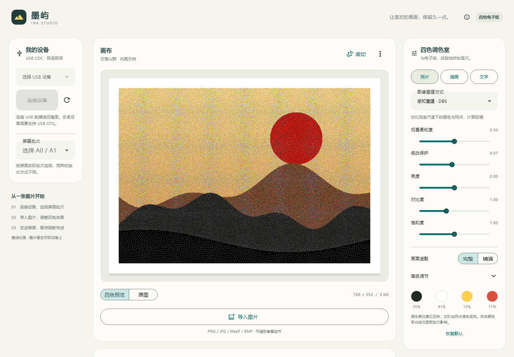
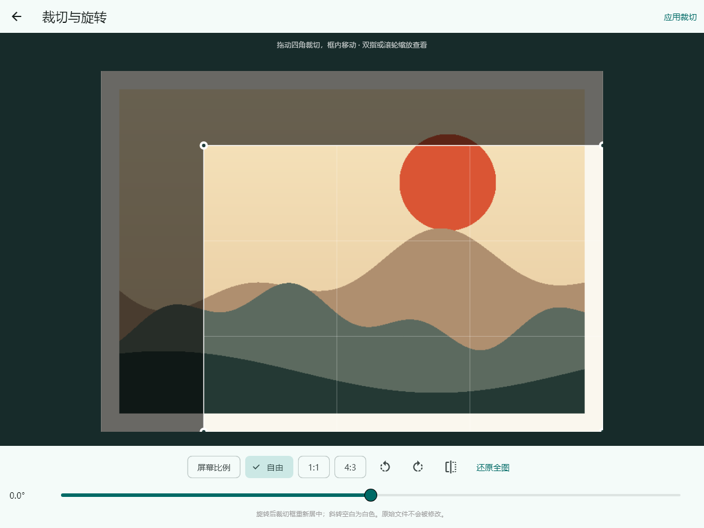

# 墨屿 · Ink Studio

面向 CH32X033 SerialEPD 的 Flutter 四色图像工作台。支持 Windows x64 串口和 Android USB OTG；图像完全在本地处理，不上传云端。





## 功能

- 枚举串口 / USB，优先显示 `1A86:FE0C`，连接后用 SEP/1 INFO 核验分辨率、格式、帧长与块大小。
- Android 显式选择 CDC ACM 驱动，避免按 WCH VID 误选 CH34x；系统负责请求 USB 权限。
- PNG / JPEG / WebP / BMP 导入，EXIF 方向、透明度合成白底。最大 25 MB、2400 万像素；超限请先缩小。动画只取第一帧，不提供动图播放。
- 自由裁切、四角缩放裁切框、框内移动、屏幕 / 方形 / 4:3 比例、任意角度旋转（0.5° 步进）、90° 快捷旋转和水平镜像。编辑基于原图，重复编辑不会累积缩放损失；原始文件不变。
- 6 种重建方式：**感知重建 · DBS**、**蓝噪声 · 色彩覆盖**、直接量化，以及筛选保留的三种传统抖动 Floyd–Steinberg、Burkes、Stucki。
- 亮度、对比度、饱和度、Gamma、抖动强度、蛇形扫描、RGB / 加权 OKLab 色彩匹配。照片、插画、文字三个快捷预设。
- 后台 isolate 处理，连续调参合并为最新任务，旧结果不会覆盖新预览。处理未完成时禁用发送。
- 原图 / 四色预览切换、缩放查看、四种颜色占比、PNG 和 `.epd` 原始帧导出、参数本地保存。
- 整帧 CRC32、逐块应答、同序号幂等重试、上传阶段取消、设备状态查询。发送进度 100% 只表示收图完成，设备报告 DONE 后才显示“画面已更新”。
- Android 传输和等待刷新期间保持当前窗口常亮；请让应用保持前台。此版不提供后台服务或跨进程恢复传输。

默认和“照片”预设采用保色 DBS：先在线性光空间分配四色覆盖率，再以蓝噪声采样，最后交换网点位置，降低观看尺度下的误差。全局四色占比保持不变，灰阶区域不会引入红黄网点。旧配置中的已移除算法会迁移到保留项；升级后点击“照片”即可体验新算法。观看柔和度控制优化尺度；纸白保护减少近白背景散点，但会舍弃极浅层次，需要时调到 0。

保留的三种扩散方式继续扩散 RGB 误差，OKLab 匹配使用 `ΔL² + 4(Δa² + Δb²)`。所有预览均基于理想 sRGB 四色，尚未测量实体面板色度。原理、开源差异、对比图和实测耗时见 [图像重建研究与验证](../docs/image-reconstruction.md)。

当前面板的原生输出只有黑白黄红，视觉灰阶通过网点混色产生；未找到可验证的每色多级灰度驱动，详见 [灰度能力核查](../docs/panel-grayscale.md)。

## 使用

1. Windows：完整解压发布 ZIP，运行 `ink_studio.exe`，保留同目录 DLL 和 `data/`。需要 Windows 10/11 x64；若提示缺少 VC 运行库，安装微软 Visual C++ 2015–2022 x64 Redistributable。
2. Android：安装 APK，通过支持数据传输的 OTG 线连接设备；展开“我的设备”，搜索并连接，允许系统 USB 授权。需要 Android 7.0 / API 24 或以上及 USB Host 支持。
3. 根据屏幕实际批次选择 A0 或 A1，软件不猜测批次。连接时不重置屏幕事务；点击发送才建立写入会话。
4. 导入图片，点击画布右上角“裁切”。拖动四角选区域，框内拖动调整位置，可自由旋转、镜像；点“应用裁切”才保存，返回则放弃。自由比例裁切后默认完整放入屏幕并留白；选择“屏幕比例”可直接铺满。重新打开编辑器可以修改选择，点“还原全图”恢复原始范围。
5. 选算法并调整效果；“完整”保留所选范围，“铺满”会再次居中裁剪至屏幕比例。PNG 与发送帧来自同一次处理结果。裁切范围仅属于当前图片，不会套用到下次导入；退出应用不保存图片工程。
6. 点击发送，依次等待准备、传输、刷新和完成。初始化最长可等待约 7 分钟，刷新最长约 4 分钟；这些是故障上限，不是典型耗时。
7. 上传可取消；刷新启动后不能取消。连接中断或应答超时先查询状态，软件不会自动重新发起一次刷新。跨断电/复位不续传。

当前 APK 使用开发调试证书签名的 **Release 优化构建**，供本地验证，不是商店正式发行签名。正式发布前请配置自有密钥；不要提交密钥文件。Windows 包未做代码签名。

## 构建

已验证 Flutter 3.41.9 / Dart 3.11.5，依赖版本由 `pubspec.lock` 固定。使用标准 Flutter 工具：

```powershell
cd app
flutter pub get
flutter analyze
flutter test
flutter build windows --release
flutter build apk --release
```

Windows 需要带 C++ 桌面开发组件的 Visual Studio；Android 需要 JDK 17、Android SDK 36、NDK 28.2.13676358，以及自行接受所用 SDK 许可。仓库没有包含 SDK、本机路径或签名密钥。

若 Google / Gradle Maven 下载失败，可显式使用仓库内的可选阿里云镜像脚本；它只影响该次构建，不修改全局配置：

```powershell
cd app/android
.\gradlew.bat assembleRelease -I ..\..\tools\gradle-mirrors.init.gradle '-Ptarget-platform=android-arm,android-arm64,android-x64' '-Ptarget=lib/main.dart' --max-workers=2 '-Dhttps.protocols=TLSv1.2' '-Djava.net.preferIPv4Stack=true'
```

需先执行一次 `flutter pub get` 并由 Flutter 生成 Android 本机配置。APK 输出在 `app/build/app/outputs/apk/release/app-release.apk`，Flutter 常规构建还会复制到 `app/build/app/outputs/flutter-apk/`。跨盘符 Pub 缓存的 Kotlin 增量编译已在项目中关闭，避免相对路径错误。

Windows 输出在 `app/build/windows/x64/runner/Release/`，必须打包整个目录。`python tools/package_app.py` 从仓库根目录收集 Windows 目录和 Android APK，生成 `build/releases/` 包与 SHA256 校验。

## 验证与目录

在仓库根目录先运行 `python tools/test.py` 构建真实 C 协议 / EPD 模拟库，再进入 `app` 执行 `flutter test`。缺少模拟库时两项固件 FFI 测试会明确跳过；不可将此报告为固件互通验证完成。

- `lib/imaging/`：解码、缩放、调色、抖动、2bpp 打包。
- `lib/protocol/`：SEP/1 COBS / CRC、会话、重试、上传状态机。
- `lib/transport/`：Windows libserialport 与 Android usb_serial 适配。
- `lib/studio_controller.dart`：连接、图像任务、导入导出、参数持久化。
- `lib/main.dart`：中文响应式界面。
- `test/`：编码向量、异常帧、颜色与图像、取消和丢应答、C 固件互通、异步处理和响应式布局。

界面截图由真实 Flutter widget 渲染生成；它们不是设备已连接或实物刷屏的证据。完整验收边界见 [应用验证记录](../docs/app-validation.md) 和 [固件验收记录](../docs/validation.md)。

## 参考与许可

- [USB Serial 插件](https://pub.dev/packages/usb_serial)、[Flutter libserialport](https://pub.dev/packages/flutter_libserialport)：原生串口 API。
- [image](https://pub.dev/packages/image) 与其[滤镜文档](https://github.com/brendan-duncan/image/blob/main/doc/filters.md)：图像编解码及扩散算法参考。
- [Björn Ottosson 的 OKLab 原文](https://bottosson.github.io/posts/oklab/)：sRGB 到 OKLab 矩阵；本项目另外加入色度权重。
- DBS 数学实现改编自 [OpenDisplay epaper-dithering](https://github.com/OpenDisplay/epaper-dithering) 和 [OpenDithering](https://github.com/guysie/opendithering)，MIT 许可已随应用收录。覆盖率路径参考公开思路，自行实现，详见研究文档。
- 关于按钮可查看 Flutter 收集的第三方开源许可。Windows 动态链接的 libserialport 采用 LGPL；[源代码和许可](https://github.com/sigrokproject/libserialport)及 [Flutter 构建包装](https://github.com/jpnurmi/flutter_libserialport)。请保留发布包中的许可与可替换 DLL。

当前仅生成 Windows、Android 原生工程；macOS、Linux、iOS、Web 未验证，不应视为已支持。
