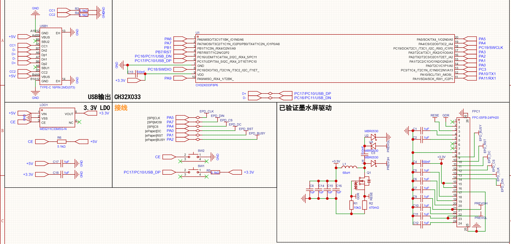

# 硬件与屏幕驱动

以用户提供的 CH32X033F8P6 原理图为基线。GPIO 名称、3.3V 供电和两颗按钮功能已据图配置，未假设其他开发板默认接线。

## 引脚与电源

| 屏幕/USB 信号 | MCU | 封装脚号 | 固件配置 |
| --- | --- | --- | --- |
| EPD_CLK | PA5 | 20 | SPI1 SCK，Mode 0 |
| EPD_DIN | PA7 | 2 | SPI1 MOSI，单线发送 |
| EPD_CS | PA4 | 19 | 软件片选，默认高 |
| EPD_DC | PA0 | 14 | 推挽输出 |
| EPD_RST | PA1 | 15 | 推挽输出，空闲/错误时低 |
| EPD_BUSY | PA2 | 16 | 输入下拉，低表示忙 |
| D− | PC16 | 5 | USBFS DM |
| D+ | PC17 | 6 | USBFS DP，内部 1.5k 上拉 |
| SWDIO | PC18 | 8 | 保留给 WCH-Link |
| SWCLK | PC19 | 18 | 保留给 WCH-Link |

SPI 时钟来自 48MHz 系统时钟，16 分频得到 3MHz，低于参考项目的 4MHz。每次 SPI 写入有 20ms 超时；同时等待 TXE 和 BSY 清除后再改变 CS/DC。一次 DATA 最多写 4 行，长时间等待都在主循环状态机中进行，USB ISR 不驱动屏幕。

TIM2 提供 1ms 单调时钟。默认启用 IWDG，按 WCH 示例的 32 分频、4000 reload 配置，标称复位时间约 2.7 秒。看门狗只在主循环正常运行后喂；USB ISR 挂住、CPU 死循环或 SPI 等待无法退出时可复位恢复。看门狗在刷屏中复位可能中断画面，不能代替电源可靠性。

BUSY 使用 PA2 内部下拉：BUSY 线断开会表现为一直忙并超时，而不是误认为刷新成功。这仍不能检测所有接线故障，比如 BUSY 被意外短接到 3.3V；A0 为此还要求刷新后实际观察到 BUSY 拉低。A1 有参考项目记录的 BUSY 提前释放行为，保留至少 14 秒等待，实际批次仍需验收。

本电路 LDO 将 USB 5V 转为 3.3V，MCU、屏幕驱动逻辑共用 3.3V。没有独立屏幕供电开关的 MCU 引脚；固件通过屏幕 POWER_OFF / DEEP_SLEEP 命令收尾，不能软件关闭整板 LDO。USB 描述符沿用 WCH 示例的 100mA 总线供电声明，需实测刷屏峰值电流后决定是否修改 `bMaxPower`，目前没有电流测量证据。

## 按钮

- SW2 把 CE 拉低，关闭 LDO，会使 MCU 与屏幕驱动电路一起掉电。它不是可由固件读取的按键。
- SW1 通过 5.1k 把 USB D+ 拉到 3.3V，接在 USB 数据线上。固件不扫描、不复用 D+ 作为普通按键；USB 正常通信期间不要按住它。它与芯片出厂下载模式的实际关系需按 WCH 芯片手册/工具确认，本固件没有重新定义出厂 Bootloader。
- PC18/PC19 不作屏幕或日志用途。主循环不调用 USART_Printf_Init，避免调试串口占用 PA2 等已连接到屏幕的引脚。

## A0

复位：RST 高 20ms、低 40ms、高至少 50ms；BUSY 就绪后再等 30ms。写 PSR=`0x0B`，TRES=768×552，POWER_ON；参考序列在写 RAM 前重复一次 POWER_ON。

每行先配置 `0x83` 窗口，再 `0x10` 和 192 字节图像。行号映射：前 276 行写 gate 0,2,4,...550，后 276 行写 gate 551,549,...1，覆盖所有 552 行且不重复。完成后设全屏窗口并 `0x12 0x00`。只有 BUSY 曾低且稳定恢复高至少 100ms 才结束刷新；45 秒超时。

## A1

复位、解锁 `0xAA`、驱动输出、PSR、升压、TCON、PLL、VCOM、TRES、级联配置顺序参考 MoInk。面板 TRES 为 768×600；初始化窗口覆盖 600 gate。

写图时设窗口 x=0..767、y=0..551，发送一次 `0x10` 后整个图像数据阶段保持 CS 低，按主机到达顺序直接写入。无需 600 行的帧缓存，未发送额外 48 行。提交时切换为 0..599 的刷新窗，与参考驱动一致。A1 的初始化 BUSY 上限 180 秒，重复 POWER_ON 上限 45 秒；刷新 BUSY 上限 180 秒，且至少等待 14 秒、BUSY 高稳定 500ms。

**待实机验证的关键差异**：参考 ESP32 把整帧连续快速发到 SPI，本实现会在 CS 低期间停钟等待 USB 分块，可能跨越数秒。控制器是否允许这些停顿，以及 A1 600 gate 刷新窗对这批屏是否适用，需要用本板实测。若此批次不允许停顿，应增加外部帧存储或采用经实测确认的分行窗口写法，不能在没有证据时宣称可靠。

## 图像方向

MoInk 网页 `packIdx()` 先把图像旋转 180°，其驱动又反向取行并镜像行内像素。两个变换抵消后，SPI 实际发出普通的左上原点行优先数据。本协议直接采用这个格式，软件测试对两种变换的等价性作了检查。

屏幕在外壳中的安装方向仍由实物决定。先显示带 TOP LEFT、BOTTOM RIGHT 和箭头的测试图，确认四种颜色、方向、行边界。需要改变安装方向时在主机转换阶段使用 `--rotate`，不要随意改底层 A0 gate 映射。

## 首次实机验收

1. 用 WCH-Link 烧录，确认 USB 能枚举为 SerialEPD，INFO 返回 768×552、max_chunk=768。
2. 先不接屏或让 BUSY 保持低，验证 STATUS 能返回初始化超时，USB 不假死；恢复连接后可重新 BEGIN。
3. 选择正确 A0/A1 批次，发送测试图，观察初始化、上传、刷新、DONE 是否依次完成。
4. 检查四种颜色、左右上下方向、A0 上下半屏交界、A1 可视区边界；用逻辑分析仪验证 CS/DC/SPI/BUSY 与状态一致。
5. 上传中断开串口/暂停超过 30 秒，确认不出现主动刷新；注意 USB 断电和仅关闭串口是不同事件。关闭串口不直接取消事务，30 秒超时最终取消。
6. 刷新期间重复 COMMIT、只读 STATUS，确认只出现一次刷新波形且 USB 持续响应。
7. 测量 3.3V 电源压降、刷新峰值电流、长线 USB 枚举稳定性，并测试 Windows/Linux 的实际驱动绑定。没有这些测量前不声称整机量产可靠。
