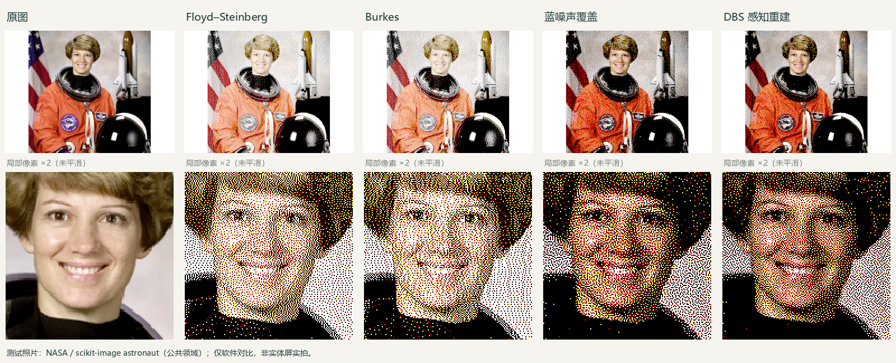

# 四色图像重建：实现、筛选与验证

Ink Studio 0.3.0，2026-10-28。针对理想黑白黄红调色板，重点是保留明暗与可表示的色彩层次，同时减少低频团块、规则纹理和灰区彩点。没有对所有图片、观看距离和实体面板都最优的算法；当前也没有实物色度标定。

## 开源研究与实现差异

| 来源 | 借鉴点 | 本项目处理 |
| --- | --- | --- |
| [Frans-Willem/epd-dither](https://github.com/Frans-Willem/epd-dither)及其 [decomposition.md](https://github.com/Frans-Willem/epd-dither/blob/master/docs/decomposition.md) | 先将颜色分解成墨色覆盖率，再选择网点分布；与直接最近色误差扩散不同 | 只研究公开思路，未复制 AGPL 代码或资源。针对 BWYR 自行推导加权保亮度投影。 |
| [paperlesspaper/epdoptimize](https://github.com/paperlesspaper/epdoptimize) | 线性光、面板色域、覆盖率与蓝噪声；实际调色板影响结果 | 未移植源码。当前使用理想四色，不把其他屏的测量值冒充华为屏数据。 |
| [OpenDisplay/epaper-dithering DBS](https://github.com/OpenDisplay/epaper-dithering/blob/main/packages/rust/core/src/dbs.rs)，上游 [OpenDithering](https://github.com/guysie/opendithering) | 优化经过视觉模糊后的亮度 / 色度误差，搜索换色与邻点交换 | MIT 数学实现移植到 Dart，许可随应用。改为只交换邻点，保持初始四色占比，避免无限制换色导致的色调漂移。 |
| [Ulichney void-and-cluster 方法](https://cv.ulichney.com/papers/1993-void-cluster.pdf) | 将网点能量推向较高空间频率，减轻可见团块 | 自编生成器产生 128×128 秩表，固定随机种子；运行时确定性采样，无网络资源。 |

OpenDisplay 读取的 `dbs.rs` Git blob：`24d92cf7f1a28ff7f5e16009ab06bed42331c6c7`。许可与改动说明见 `app/assets/licenses/reconstruction.txt`。

## 两种新重建

1. **蓝噪声 · 色彩覆盖**：将 sRGB 还原到线性光，投影到 `0≤B≤G≤R≤1` 的四色色域；越界通道用亮度权重合并，保持线性亮度。墨色比例为黑 `1−R`、白 `B`、黄 `G−B`、红 `R−G`。用蓝噪声秩表作空间采样。灰度只能分解成黑白，因此没有红黄杂点。
2. **感知重建 · DBS**：以上述结果为起点，在亮度 / 色度空间用不同尺度的高斯模型，迭代邻点交换；只接受降低目标误差的交换，最多三轮。禁止把某色移入覆盖率为零的区域，保护中性灰、纯墨色和近白背景。它保持全局占比，不保证每个局部区域占比完全不变。

“观看柔和度”对应像素空间的优化尺度，并非准确的视距 / PPI 模型；较高数值不保证更好。“纸白保护”把极浅背景固定成白色，减少纸面散点，也会损失微弱层次，设为 0 可关闭。默认照片预设采用 DBS。最终输出始终是 2bpp 原生四色，并没有增加硬件颜色。

## 为什么传统抖动只留下三种

根据同一标准照片在相同设置下的结果，保留：Floyd–Steinberg（细节基线）、Burkes（较平滑且计算适中）、Stucki（更大范围的扩散）。删除 Atkinson、JJN、Sierra、Sierra Lite 和两个 Bayer。小尺度误差与较大尺度误差存在取舍，这三种是当前样本与功能差异下的选择，不是所有图像的绝对前三。

旧偏好迁移：Atkinson → Burkes，JJN / Sierra → Stucki，Sierra Lite → Floyd–Steinberg，Bayer → 蓝噪声；其它调色参数保留。菜单共 6 项：这三种传统抖动、两种新重建、直接量化。删除的算法可从历史提交 `490d46b` 找回，发布版本不保留隐藏入口或无用内核。

## 可复现的软件对比

样本：[scikit-image astronaut](https://scikit-image.org/docs/0.20.x/api/skimage.data.html#skimage.data.astronaut)，NASA 公共领域照片。原始数据来自 [scikit-image v0.19.3](https://raw.githubusercontent.com/scikit-image/scikit-image/v0.19.3/skimage/data/astronaut.png)。768×552 完整留白，默认调色参数、OKLab 旧算法匹配、纸白保护 0.07；单次本机 Dart JIT 处理耗时包含解码和 PNG 编码，不代表 Android 性能。

| 方法 | 高斯 σ=1 线性 RGB MSE | σ=2 MSE | 单次耗时 ms |
| --- | ---: | ---: | ---: |
| Floyd–Steinberg | 0.028404 | 0.027002 | 247 |
| Burkes | 0.028530 | 0.026682 | 207 |
| Stucki | 0.028610 | 0.026732 | 213 |
| Atkinson（已移除） | 0.043462 | 0.041515 | 197 |
| JJN（已移除） | 0.028875 | 0.026794 | 213 |
| Sierra（已移除） | 0.028690 | 0.026758 | 207 |
| Sierra Lite（已移除） | 0.028613 | 0.027227 | 192 |
| Bayer 4×4（已移除） | 0.076871 | 0.074171 | 149 |
| Bayer 8×8（已移除） | 0.076845 | 0.074126 | 150 |
| 蓝噪声覆盖 | 0.001333 | 0.000341 | 194 |
| 保色 DBS | 0.000995 | 0.000298 | 812 |

上述 MSE 是对输出与目标的**线性 RGB 差值进行高斯滤波后求均方值**，越小表示该尺度的颜色平均值越接近。它是软件代理指标，不是人眼噪点评分，也不是屏幕实拍评价。新旧算法最大的差异来自线性光与 gamma 编码空间的混色处理，不能把全部指标差距归因于网点形状。未测量面板的反射率、墨色交互或环境光。

DBS 对自身视觉目标的误差由 3079.93 降到 1823.12，下降约 40.8%；相对蓝噪声的独立 σ=1 MSE 降约 25.3%。两者四色像素数量完全一致 `[186588,183459,9456,44433]`。这些数字只对应此样本，不能外推到所有图片。



图上排用线性光面积平均缩小，模拟空间融合；下排是同一局部的最近邻 2 倍放大，明确显示真实网点，未做降噪美化。应用缩小预览会重采样，导出 PNG 和传输帧仍是原始四色像素。

复现：先将上面照片保存到 `build/quality/astronaut.png`，然后执行：

```powershell
cd app
dart run tool/compare_algorithms.dart ../build/quality/astronaut.png --all
cd ..
python tools/compare_quality.py
```

Python 对比脚本需要 Pillow、numpy、scipy。`--all` 评估当前保留方法；历史方法的记录来自精简前同一处理链，原始数字保存在 `docs/algorithm-selection.json`。

裁切、图片处理和传输的功能验收见 [应用验证](app-validation.md)；原生灰度核查见 [面板灰度能力](panel-grayscale.md)。
