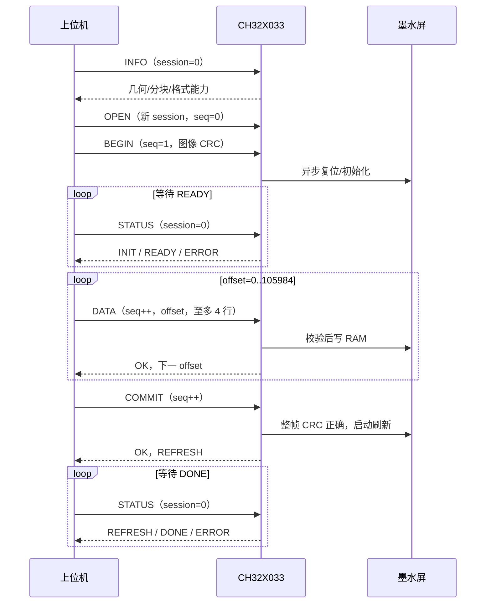

# SEP/1 串口墨水屏通信规范

版本：1；固件：0.1.0。所有多字节整数为**无符号、小端**。一个 CDC 字节流只允许一个写入者；读状态可使用无会话查询。协议不以 USB 包边界或串口 read/write 调用边界分帧。

## 1. 字节流封装

```text
COBS(header[16] + payload[N] + crc32[4]) + 00
```

采用标准 COBS；编码体不含 00，00 为结束分隔符。允许帧前附加 00，连续空分隔符忽略。发送方每次重试前先发送 00，确保上次半帧被丢弃。

| 原始偏移 | 长度 | 名称 | v1 约束 |
| --- | --- | --- | --- |
| 0 | 1 | version | 1 |
| 1 | 1 | command | 命令号，应答回显 |
| 2 | 2 | flags | 请求 0，应答 1；其他位必须为 0 |
| 4 | 4 | sequence | 请求序号，应答回显 |
| 8 | 4 | session | 会话号，应答回显 |
| 12 | 2 | payload_length | 0..772 |
| 14 | 2 | reserved | 必须 0 |
| 16 | N | payload | 命令参数或应答 |
| 16+N | 4 | crc32 | 前面 header+payload 的 CRC32 |

CRC 使用 CRC-32/ISO-HDLC：反射多项式 `0xEDB88320`，初值 `0xFFFFFFFF`，最终异或 `0xFFFFFFFF`。与 Python `zlib.crc32(data)` 一致，`123456789` 的结果为 `0xCBF43926`。CRC 字段本身仍按小端传输。

最大解码长度 792 字节；含分隔符保守上限 797 字节。坏 COBS、解码长度不符、超长、CRC 错误的帧**静默丢弃**，不信任损坏的 session/sequence；上位机超时后重试。错误计数可在 STATUS 查询。半帧超过 2 秒未收到下一字节会进入丢弃状态，直到下一个 00 才重新同步；完整超长帧同样丢到 00。定时器比较支持 32 位毫秒回绕。

CRC 负责随机损坏检测，不是鉴权、加密或恶意发送者防护。

## 2. 会话、序号与重试

1. 使用非零随机 uint32 会话号，发送 `OPEN(sequence=0, session=新值)`。
2. OPEN 成功后有状态请求序号从 1 开始，每次**执行层返回结果后**加 1，包括参数错误、BUSY、OFFSET 等结果。
3. 每次只允许一个未得到应答的有状态请求。超时重传时，version/command/sequence/session/payload 必须完全一致。
4. 设备缓存最后一个已执行请求的完整字节与应答。完全相同的重传只重放应答，不重新写屏、不重新刷新。用同一序号改参数会返回 SEQUENCE。
5. 无会话 INFO/STATUS 不占用序号、不覆盖重复请求缓存。普通会话 STATUS/INFO 会占用序号。
6. 帧损坏、VERSION、请求 flags/reserved 错误、SESSION、SEQUENCE 不推进序号。OPEN 参数错误也不推进。实现时以有效应答中的 `next_sequence` 为准，但不能用旧会话应答重新同步。
7. uint32 序号溢出到 0 后不能继续有状态操作，需要新会话。一个完整上传通常仅约 140 次有状态请求。

无应答并不能判断“未执行”。尤其 COMMIT 丢应答后必须重传原始请求或只读查询 STATUS，**不能盲目新建事务重新刷屏**。缓存应答为当时快照：重放 COMMIT 可能仍显示 REFRESH，即使现在已完成；用无会话 STATUS 获取实时状态。

新 OPEN 在 INIT/READY 阶段会取消旧事务、复位屏幕并接管会话；在 REFRESH 阶段允许新会话查询，但保留正在进行的刷新，BEGIN/ABORT 仍返回 BUSY。新会话号必须不同于当前会话号；只有尚未被后续有状态命令替换的原始 OPEN 可以幂等重试。v1 不保留多请求历史，不能用延迟很久的旧请求再次执行。请求发起者应避免重用会话号。

USB 总线复位、取消配置或挂起会清空通信缓存和会话，取消未提交上传；已开始的刷新继续。重新连接必须重新 OPEN。MCU 复位/断电丢失所有事务状态，不承诺跨复位 exactly-once，也不能确认断电前某次刷新是否成功。传图阶段若仅丢失应答，原会话重传可恢复；真正断连后重新全量上传。

## 3. 所有应答的公共载荷

| 应答载荷偏移 | 长度 | 含义 |
| --- | --- | --- |
| 0 | 1 | result：本条请求的结果 |
| 1 | 1 | state：当前屏幕状态 |
| 2 | 1 | last_error：事务/异步错误，0 表示无记录 |
| 3 | 1 | driver_error：屏幕驱动错误 |
| 4 | 4 | offset：当前事务累计接受的像素字节数 |
| 8 | 4 | next_sequence：设备期待的下一个有状态请求序号 |
| 12 | 变长 | 命令特定数据 |

状态编号：0 IDLE，1 INIT，2 READY（可收图），3 REFRESH（包含断电/深睡收尾），4 DONE，5 ERROR。READY 的 offset 可为 0..105984；offset 达到总长度只表示接收完整，尚未触发刷新。错误后 offset 可能保留用于诊断，只有 READY+有效事务允许继续 DATA。

| result / last_error | 名称 | 含义 |
| --- | --- | --- |
| 0 | OK | 请求已接受；不一定已完成刷新 |
| 1 | VERSION | 不支持的主版本 |
| 2 | COMMAND | 未知命令 |
| 3 | ARGUMENT | 参数、长度、保留位不合法 |
| 4 | SESSION | 未 OPEN 或会话错误 |
| 5 | SEQUENCE | 乱序、过期、同序号不同请求 |
| 6 | STATE | 当前状态不允许操作或图像不完整 |
| 7 | OFFSET | 与设备期待的数据偏移不同 |
| 8 | CRC | 完整图像 CRC 不符，已取消事务 |
| 9 | BUSY | 初始化/刷新等占用中 |
| 10 | IO | SPI 或 BUSY 等硬件操作失败 |
| 11 | TIMEOUT | 30 秒接收空闲或 120 秒总上传期限超时 |

驱动错误：1 SPI 超时；2 初始化/上电 BUSY 超时；3 刷新 BUSY 超时；4 A0 刷新后 1 秒内未观察到 BUSY 拉低；5 断电 BUSY 超时；6 内部帧状态错误。正常 BEGIN/ABORT/非刷新期新 OPEN 会清理错误记录。STATUS 的 result=OK 仅表示查询成功，仍需检查 state/last_error/driver_error。

## 4. 命令

| 命令 | 号 | 请求载荷 | 应答扩展 |
| --- | --- | --- | --- |
| OPEN | 0x01 | 空；sequence=0，session 非零新值 | 无 |
| INFO | 0x02 | 空 | 能力 TLV |
| STATUS | 0x03 | 空 | uint32 坏帧计数 |
| BEGIN | 0x10 | 下述 16 字节参数 | 无 |
| DATA | 0x11 | uint32 offset + 1..4 行像素 | 无 |
| COMMIT | 0x12 | 空 | 无 |
| ABORT | 0x13 | 空 | 无 |

INFO / STATUS 可使用 `session=0, sequence=0`，不要求 OPEN，可在初始化、上传、刷新或错误阶段查询。其他请求使用 session=0 均不合法。

### INFO 能力 TLV

扩展区为重复的 `type:u8 length:u8 value[length]`。未知 type 按 length 跳过，不应使上位机失败。字段顺序不构成契约。

| type | length | 数据 |
| --- | --- | --- |
| 1 | 4 | width:u16=768，height:u16=552 |
| 2 | 4 | max_image_chunk:u32=768，不含 DATA 的 offset 字段 |
| 3 | 2 | panel_mask:u8=3（bit0 A0、bit1 A1），pixel_format:u8=1 |
| 4 | 3 | 固件版本 major/minor/patch=0/1/0 |
| 5 | 4 | frame_bytes:u32=105984 |

### BEGIN

| 参数偏移 | 长度 | 字段 |
| --- | --- | --- |
| 0 | 1 | panel：0=A0、1=A1 |
| 1 | 1 | format：1=原点左上、行优先、2bpp、MSB first |
| 2 | 2 | width=768 |
| 4 | 2 | height=552 |
| 6 | 2 | reserved=0 |
| 8 | 4 | total_bytes=105984 |
| 12 | 4 | image_crc32：所有 DATA 像素字节按偏移串接的 CRC32 |

只在 IDLE/DONE/ERROR 接受；INIT/READY/REFRESH 返回 BUSY，不覆盖现有事务。成功后立即应答 INIT，主循环执行屏幕复位/配置/上电。上位机轮询 STATUS，等 READY 再 DATA。A1 最坏初始化预算约 405 秒，上位机使用 420 秒期限。遇到 ERROR 应停止传图并报告错误，不能无条件重试刷新。

### DATA

像素数据长度必须为 **192、384、576 或 768** 字节；offset 从 0 开始递增，且必须与设备当前 offset 完全一致。每行 192 字节，总共 552 行。不得越过 105984 字节。只有 READY 接受；INIT 返回 BUSY，其他状态返回 STATE。

每字节表示从左到右四个像素：bit7..6、5..4、3..2、1..0；0 黑、1 白、2 黄、3 红。例如连续黑白黄红为 `0x1B`，全白为 `0x55`。图像从顶行到末行连续排列，**不需要主机翻转、不发送 A0 gate 编号，也不包含 A1 隐藏的 48 行**。

驱动按参考项目的实际输出序列发送。A0 第 j 行映射到 `j<276 ? 2*j : 2*(552-j)-1`；A1 顺序写 0..551 并持续保持数据阶段 CS 低。READY 后每个新 DATA 成功都会重置 30 秒上传空闲期限，查询和重复包重放不会延长它。此外从初始化完成起至 COMMIT 必须在 120 秒内完成，防止持续少量数据让屏幕长时间停留在上电写入状态。初始化等待不占这 120 秒。

### COMMIT

要求 READY、有效事务、完整的 105984 字节以及匹配的整帧 CRC。失败不发送 `0x12` 刷新命令。成功只发送一次刷新命令，并返回 REFRESH；后续 STATUS 到 DONE 才代表刷新及断电/深睡流程完成。A0 刷新等待上限 45 秒；A1 为 180 秒且最短等待 14 秒，随后还有断电等待及 200ms 深睡收尾。主机使用 240 秒刷新总期限。

无外部帧存储，因此刷屏失败后设备不能自己重放整张图；应检查错误、修复硬件/批次问题，再由主机重新完整上传。

### ABORT

取消 INIT/READY/DONE/ERROR 等状态的事务，释放 CS、拉低屏幕 RST，offset 清零回到 IDLE。已开始 REFRESH 时返回 BUSY，避免强制中断高压波形。断开 USB 也不强制中断已经开始的刷新（前提是电源仍在）。

## 5. 推荐流程



每条应答建议 2.5 秒超时、最多重试 3 次；查询状态建议每 100..500ms。串口被占用、USB 挂起、真实设备断电等不会被协议隐藏。发生不确定结果后先查询，再选择恢复策略。Python 客户端可原样再次调用相同 request 重试，或者显式新 OPEN；它阻止在结果未明时把当前序号用于另一条命令。

## 6. 扩展约定

主版本改变表示不兼容帧或命令语义。新增能力优先使用 INFO TLV；新增命令分配新 command；新增像素布局使用新 format；新面板使用新 panel 值并扩充能力字段。v1 拒绝未知 flags/reserved，不能在未协商时偷用这些位。不得悄悄改变 format=1 的颜色值、尺寸定义或行方向。

将来增加压缩/局刷/外部 Flash 时，必须显式公布能力并定义解压后大小、校验范围、写入原子性和恢复行为。v1 的 CRC 与 ACK 仅证明数据传输和软件流程，不能证明玻璃实际显色正确。
